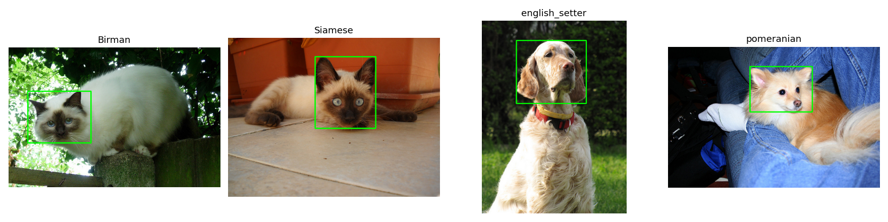
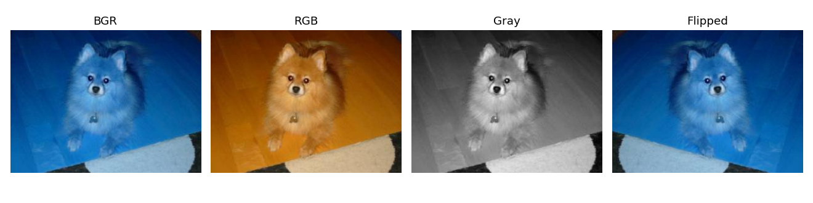

# Лабораторная работа № 1. Среда, репозиторий и первый взгляд на данные

## 1. Задача

Цель работы — познакомиться с набором данных для компьютерного зрения, изучить характеристики изображений и разметки, выполнить базовые преобразования изображений и подготовить результаты исследования.

В работе использовались OpenCV и Pillow для чтения изображений, а также инструменты Python для анализа данных и визуализации.

## 2. Как запустить

1. Открыть ноутбук `solution.ipynb` в Google Colab.
2. Убедиться, что установлено значение `VARIANT = 7`.
3. Выполнить все ячейки ноутбука последовательно через **Runtime → Run all**.
4. После выполнения проверить наличие файлов в папке `results/`.

Ноутбук загружает данные и выполняет анализ, поэтому абсолютные пути к локальным файлам не требуются.

## 3. Данные

Для варианта 7 использовались изображения четырёх пород животных:

- Birman;
- Siamese;
- English Setter;
- Pomeranian.

Всего в выборке **807 изображений**: 404 изображения кошек и 403 изображения собак.

В ходе работы исследовались размеры изображений, цветовые каналы, форматы файлов и наличие XML-разметки. Также были выполнены преобразования изображений: перевод в оттенки серого, изменение размера и отражение.

## 4. Результаты

По результатам анализа датасета получены следующие показатели:

**Общие сведения**
- Номер варианта: 7.
- Количество изображений: 807.
- Количество классов пород: 4.
- Изображения кошек: 404.
- Изображения собак: 403.

**Размеры изображений**
- Ширина: от 183 до 679 пикселей.
- Медианная ширина: 500 пикселей.
- Высота: от 150 до 798 пикселей.
- Медианная высота: 375 пикселей.

**Проверка качества данных**
- Изображения с некорректным количеством каналов: 0.
- Файлы `.jpg`, формат которых не соответствует JPEG: 0.
- Изображения с XML-разметкой: 405 из 807.

**Визуализация результатов**

Примеры изображений с ограничивающими рамками:

Результаты преобразований изображений:

Сводная статистика сохранена в файле [`summary.csv`](results/summary.csv).

## 5. Выводы

1. Для варианта 7 обнаружено 807 изображений четырёх пород: 404 изображения кошек и 403 изображения собак.
2. Медианная ширина изображений составляет 500 пикселей, а медианная высота — 375 пикселей.
3. В ходе проверки не обнаружено изображений с некорректным количеством каналов: таких файлов 0.
4. Все проверенные файлы с расширением `.jpg` соответствуют формату JPEG.
5. XML-разметка присутствует у 405 изображений из 807, что составляет примерно 50,2% датасета.
