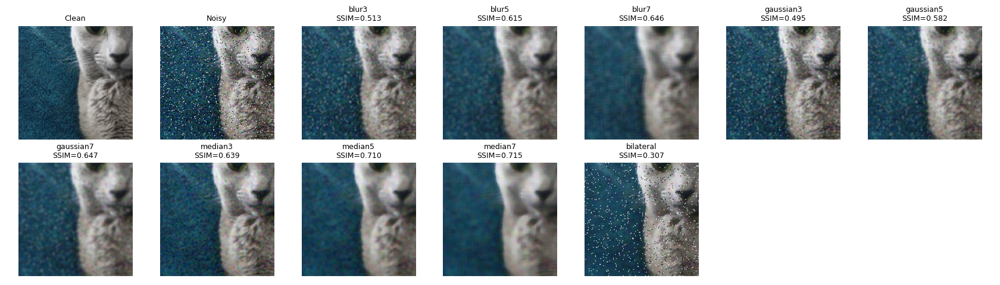
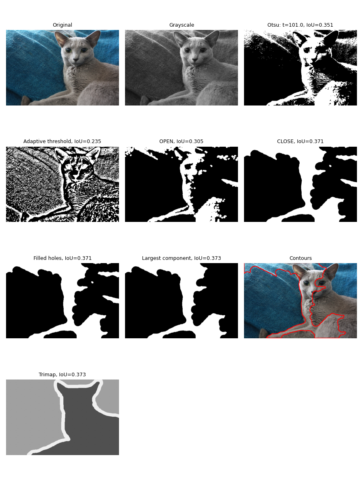
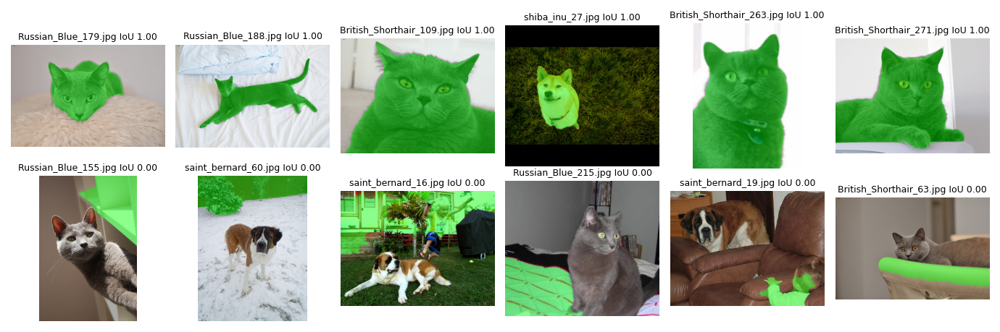

# Лабораторная работа 2. Классическая обработка изображений

## 1. Задача

Цель работы — исследовать методы коррекции освещённости и подавления шума на изображениях, сравнить фильтры по PSNR, SSIM и времени выполнения, а также реализовать классическую сегментацию животных без использования нейронных сетей. Дополнительно исследуется влияние этапов обработки на качество масок и вычисляются признаки формы объектов.

## 2. Как запустить

Работа выполнена в Jupyter Notebook в среде Google Colab.

Для повторного запуска необходимо открыть `solution.ipynb`, убедиться, что данные загружаются согласно инструкциям курса, проверить значение `VARIANT` и выполнить все ячейки последовательно с помощью **Run All**. Результаты экспериментов сохраняются в папку `results/`.

## 3. Данные

Использован вариант № **5** из набора данных курса Computer Vision.

В первой части исследовались яркость, контраст, шум и резкость изображений, методы коррекции освещённости и фильтрация зашумлённых изображений. Во второй части выполнялась сегментация животных с использованием порога Оцу, морфологических операций, заливки отверстий и выделения крупнейшей связной компоненты.

Тип шума определяется таблицей `NOISE_PLAN` для выбранного варианта.

## 4. Результаты

### Часть 1. Фильтрация изображений

В качестве итогового фильтра выбран `median7`: он показал SSIM **0.7154**, тогда как у `median5` этот показатель составил **0.7095**. При этом `median7` обрабатывает кадр в среднем за **25.6 мс**, а `median5` — за **1.7 мс**, поэтому выбор отражает компромисс между структурным качеством и скоростью обработки.

### Часть 2. Сегментация животных

Сегментация выполняется последовательным применением пороговой обработки, определения полярности, морфологических операций, заполнения отверстий и выделения крупнейшей связной компоненты. Качество оценивается метрикой IoU с игнорированием пикселей границы trimap.

При сравнении размера ядра морфологического замыкания получены значения IoU: **0.413** для `k_close=15`, **0.436** для `k_close=31` и **0.451** для `k_close=45`. В итоговой конфигурации используется **[указать фактическое значение `k_close`]** и канал **[указать выбранный канал]**.

### Файлы результатов

- `part1_stats.csv` — статистики изображений.
- `histograms.png` — гистограммы яркости и цветовых каналов.
- `illumination.png` — сравнение методов коррекции освещённости.
- `filters.csv` — метрики и время работы фильтров.
- `filters.png` — визуальное сравнение фильтрации.
- `pipeline.png` — этапы сегментации одного изображения.
- `ablation.csv` — сравнение вклада этапов сегментации.
- `masks.csv` — IoU и признаки формы для изображений.
- `best_worst.png` — лучшие и худшие результаты сегментации.

## 5. Выводы

1. **Подавление шума.** `median7` показал SSIM 0.7154 против 0.7095 у `median5`, но оказался значительно медленнее: 25.6 мс против 1.7 мс. Это демонстрирует компромисс между качеством обработки и вычислительными затратами.
2. **Морфологическое замыкание.** При увеличении `k_close` с 15 до 45 средний IoU вырос с 0.413 до 0.451. Это указывает на то, что более крупное ядро в данном эксперименте помогло улучшить маски, хотя его влияние на границы объектов также необходимо учитывать.
3. **Неудачные случаи сегментации.** На 208 из 805 изображений IoU оказался ниже 0.2. Среди причин — ошибки эвристики полярности, при которых фон может выделяться вместо животного.
4. **Различия между группами изображений.** Средний IoU для кошек составил 0.478, для собак — 0.395. Это показывает, что качество классической сегментации зависит от визуальных характеристик объектов и их контраста с фоном.
5. **Различия между породами.** Наименьший средний IoU среди пород получен для `shiba_inu` — 0.384. Это указывает на необходимость учитывать сложные случаи и ограничения эвристических методов при обработке изображений разных животных.
